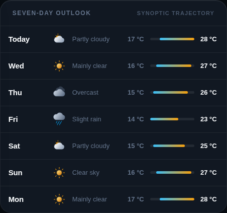
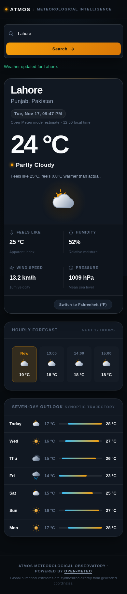

<div align="center">

# Atmos

### Weather, Clearly Presented.

A responsive weather application featuring deterministic location matching, real-time meteorological conditions, and synoptic multi-day forecasts.

[](https://open-meteo.com/)
[](https://developer.mozilla.org/docs/Web/JavaScript)
[](https://developer.mozilla.org/docs/Web/CSS)
[](https://developer.mozilla.org/docs/Web/HTML)
[](tests/)

[Visual Preview](#visual-preview) &bull;
[About Atmos](#about-atmos) &bull;
[Features](#features) &bull;
[Location Search](#location-search) &bull;
[Weather Data & Accuracy](#weather-data--accuracy) &bull;
[Technology Stack](#technology-stack) &bull;
[Quick Start](#quick-start) &bull;
[Testing & Verification](#testing--verification) &bull;
[Project Structure](#project-structure)

</div>

---

## Visual Preview

<div align="center">

### Observatory Desktop Experience

<p align="center">
  
  
</p>

### Synoptic Trajectory & Responsive Reflow

<p align="center">
  
  
</p>

</div>

---

## About Atmos

**Atmos** is an editorial weather intelligence application designed to deliver atmospheric data with precision, typographic elegance, and clarity. 

Standard weather applications often suffer from cluttered card grids, generic dashboard widgets, or ambiguous location lookups where searching for a common city name silently defaults to the wrong country or continent. Atmos solves this with an intentional meteorological observatory interface:
- **Deterministic Location Disambiguation:** Resolves queries with regional intelligence, prioritizing regional centers and explicitly presenting candidate choices when names conflict.
- **Hierarchical Meteorological Visualization:** Prioritizes the primary current temperature while providing supporting telemetry (apparent temperature, relative humidity, 10m wind velocity, and mean sea-level pressure).
- **Synoptic Forecast Rail & Temperature Range Bars:** Visualizes weekly thermal trajectories through proportional, clamped range bars that immediately communicate daily highs, lows, and shifts.
- **Zero-Build Architecture:** Built entirely in Vanilla HTML5, CSS3, and ES2020 JavaScript, requiring zero compile steps, zero bundle overhead, and zero client-side framework bloat.

All meteorological data and coordinate lookups are synthesized directly from [Open-Meteo](https://open-meteo.com/).

---

## Features

### 1. Intelligent Location Search
- **Pakistan-First Resolution:** Prioritizes domestic administrative centers for unqualified search terms (e.g. `Lahore`, `Karachi`, `Islamabad`).
- **Global Fallback:** Automatically falls back to global coordinates when a query has no domestic match (e.g. `London`, `Tokyo`).
- **Regional Context Resolution:** Respects explicit administrative context, such as `Paris, Texas, USA` or `Mirpur, Azad Kashmir`.
- **Candidate Disambiguation:** If a query matches multiple valid locations with the same name, Atmos renders interactive candidate selection buttons displaying region, country, and geographic coordinates.

### 2. Current Weather Conditions
- **Focal Temperature Display:** Rendered with dominant typographic scale and tabular numerals to prevent layout shift.
- **Solar Day/Night Differentiation:** Evaluates solar elevation (`is_day`) to render context-aware vector illustrations (`clear-day` vs `clear-night`, `partly-cloudy-night`, and `showers-night`).
- **Contextual Feels-Like Calculation:** Analyzes apparent temperature against actual air temperature to render explanatory context (e.g., *"feels 0.8°C warmer than actual"*).
- **Four-Cell Telemetry Instrumentation:** Displays apparent temperature, relative humidity percentage, 10m wind velocity in km/h, and mean sea-level pressure in hPa.

### 3. Hourly and Seven-Day Forecasts
- **12-Hour Timeline Rail:** Horizontal scroll rail mapping upcoming hourly temperatures and condition icons using local wall-clock timestamps.
- **Seven-Day Synoptic Outlook:** Weekly overview showing day names, weather conditions, and relative temperature range bars.
- **Clamped Range Bars:** Visual bars are mathematically bounded against the weekly extremes (`weekMin` and `weekMax`), utilizing a cool-cyan to warm-amber linear gradient with fallback handling for flat-variance days.

### 4. Temperature Unit Conversion
- **Lossless Toggle:** Supports switching between Celsius (°C) and Fahrenheit (°F).
- **Raw Value Preservation:** Internal state maintains raw Celsius readings from Open-Meteo, computing Fahrenheit conversions on display to prevent cumulative rounding errors.

### 5. Responsive User Experience
- **Asymmetric Desktop Cockpit (≥ 1024px):** Container width expands to `1180px` in a 1.45fr / 1fr two-column layout, pairing the hero card and hourly rail alongside the seven-day synoptic outlook.
- **Fluid Tablet & Mobile Reflow (≤ 768px):** Stacks gracefully into a single-column layout, reflowing telemetry cells into a 2x2 grid and adapting day forecast rows for narrow screens.
- **Zero Horizontal Overflow:** Verified across 320px, 360px, 375px, 390px, 430px, 768px, 1024px, 1280px, and 1440px viewports.

### 6. Accessibility & Reliability
- **WCAG Compliant Contrast:** High-contrast text on deep observatory canvas (`#080C10` and `#111822`).
- **Accessible ARIA Regions:** Includes a skip navigation link, semantic `<main>`, `<header>`, `<footer>`, `<time>`, and an ARIA live region (`role="status" aria-live="polite"`).
- **Motion Sensitivity:** Respects user system preferences via `@media (prefers-reduced-motion: reduce)`.
- **Stale-Request Guard:** Utilizes an internal sequence counter and `AbortController` to discard outdated responses from delayed network queries.

---

## Location Search

Atmos implements a structured multi-pass geocoding resolution pipeline to ensure queries resolve reliably:

| Search Query | Resolution Strategy | Expected Result |
| :--- | :--- | :--- |
| `Lahore` | Priority domestic lookup for unqualified name | Lahore, Punjab, Pakistan |
| `London` | Domestic lookup yields no match; automatically triggers global search | London, England, United Kingdom |
| `Paris, Texas, USA` | Context-aware filter enforcing city, region, and country alias | Paris, Texas, United States |
| `Mirpur` | Multiple exact-name candidates found; presents candidate selector | Inline selection: Azad Kashmir vs Punjab |
| `Mirpur, Azad Kashmir` | Explicit administrative context resolves ambiguity | Mirpur, Azad Kashmir, Pakistan |

When multiple locations match, candidate buttons display full provenance:
```text
[ Mirpur, Azad Kashmir, Pakistan (33.15°, 73.75°) ]
[ Mirpur, Punjab, Pakistan (30.12°, 71.65°) ]
```

---

## Weather Data & Accuracy

Atmos integrates directly with the [Open-Meteo API suite](https://open-meteo.com/):

1. **[Geocoding API](https://open-meteo.com/en/docs/geocoding-api):** Resolves city names to geographic coordinates (latitude, longitude), administrative regions, country codes, and population data.
2. **[Forecast API](https://open-meteo.com/en/docs):** Delivers current meteorological conditions, hourly timelines, and daily synoptic aggregates.

### Parameters & Constraints
- **Coordinates & Grid:** Atmospheric models synthesize data using model grid points nearest to the requested coordinates. Model coordinates may differ slightly from municipal center coordinates.
- **Timezone Detection:** Configured with `timezone=auto`, ensuring timestamps and local time reflect the target municipality's actual wall-clock time.
- **Standardized Units:** Requests data in standard Celsius (`temperature_unit=celsius`) and kilometer-per-hour (`wind_speed_unit=kmh`).

### Operational Truth & Weather Model Disclaimer
Current weather conditions and forecasts are **numerical weather-model estimates** computed by meteorological simulation pipelines. They do not represent direct, real-time sensor measurements from a physical weather station. Accuracy, forecast horizon, and update intervals vary by geography and atmospheric dynamics.

---

## Technology Stack

Atmos is intentionally built with lightweight, standards-compliant web technologies:

- **Markup:** HTML5 (Semantic elements, ARIA attributes, SVG icons)
- **Styling:** CSS3 (Custom properties, CSS Grid, Flexbox, media queries, prefers-reduced-motion)
- **Application Logic:** Vanilla JavaScript ES2020 (Fetch API, AbortController, Intl DateTimeFormat)
- **Typography:** System font stack with `tabular-nums` formatting
- **Weather Data:** [Open-Meteo REST APIs](https://open-meteo.com/) (Free tier, no API key required)
- **Testing & Verification:** Node.js test runner and [Puppeteer](https://pptr.dev/) for headless Chromium E2E verification

---

## Quick Start

Atmos is a zero-build static web application. It requires no compilers, bundlers, or package installations to run the user interface.

### Running the Application

1. Clone the repository:
   ```bash
   git clone https://github.com/nabihanasir1804-art/clima-track.git
   cd clima-track
   ```

2. Start a local HTTP server using Python 3:
   ```bash
   python3 -m http.server 8000
   ```

3. Open your browser and navigate to:
   ```text
   http://localhost:8000
   ```

---

## Testing & Verification

Automated testing requires Node.js (v18+) and npm to execute unit checks and browser automation via Puppeteer.

### 1. Install Test Prerequisites
```bash
npm ci
```

### 2. Deterministic Automated Test Suite
Run all unit tests and headless Chromium E2E tests against local fixtures:
```bash
npm test
```

The test runner executes:
- `tests/ranking.js` (55 tests) — Location ranking, administrative hierarchy, and tie-breaking.
- `tests/conversions.js` (23 tests) — Mathematical temperature conversion and display rounding.
- `tests/geocoding.js` (31 tests) — Domestic vs. global fallback queries and contextual validation.
- `tests/e2e.js` (26 tests) — Chromium browser workflow, UI rendering, and multi-viewport overflow checks across 9 screen widths.

**Current Test Status:** **135 passed, 0 failed.**

### 3. Live Open-Meteo Provider Verification
*Note: These commands make live outbound network requests to Open-Meteo endpoints and require an active internet connection.*

```bash
npm run verify:mirpur            # Live geocoding queries for Mirpur ambiguity
npm run verify:live:matrix       # Comprehensive 42-location provider matrix
npm run test:e2e:live            # Live Chromium browser tests for 8 international cities
npm run test:e2e:live:mirpur     # Live browser tests across Mirpur queries
```

---

## Project Structure

```text
clima-track/
├── index.html                  # Semantic HTML application layout & ARIA live regions
├── css/
│   └── style.css               # Design system tokens, observatory theme, responsive grid
├── js/
│   └── app.js                  # Geocoding resolution, API client, DOM rendering, unit toggling
├── assets/                     # High-resolution documentation screenshots & preview art
│   ├── screenshot-welcome.png  # Desktop welcome screen preview
│   ├── screenshot-lahore-weather.png # Desktop active weather dashboard
│   ├── screenshot-forecast.png # Focused view of seven-day synoptic outlook
│   ├── screenshot-mobile.png   # Full-page mobile responsive reflow
│   ├── e2e-welcome.png         # E2E test runner screenshot fixture
│   └── e2e-haripur.png         # E2E test runner loaded state screenshot fixture
├── tests/                      # Automated unit, E2E, and live verification suites
│   ├── ranking.js              # Location ranking & candidate scoring tests
│   ├── conversions.js          # Temperature conversion unit tests
│   ├── geocoding.js            # Geocoding endpoint & fallback tests
│   ├── e2e.js                  # Puppeteer Chromium E2E integration test suite
│   ├── capture-viewports.js    # Multi-viewport screenshot generation script
│   ├── verify-mirpur.js        # Live Mirpur geocoding diagnostics
│   ├── live-matrix.js          # Live 42-city weather matrix validator
│   └── e2e-live.js             # Live Chromium browser test suite
├── package.json                # Test scripts and Puppeteer development dependency
├── package-lock.json           # Locked dependency tree
└── README.md                   # Repository documentation and engineering guide
```

---

## Data Sources & Acknowledgements

Atmos relies on open meteorological data provided by [Open-Meteo](https://open-meteo.com/):

- **[Open-Meteo Weather API](https://open-meteo.com/):** Open-source weather API providing high-resolution numerical weather models.
- **[Open-Meteo Geocoding API](https://open-meteo.com/en/docs/geocoding-api):** Worldwide spatial geocoding and populated-place search service.

---

## License

No license file is currently included in this repository. All rights are reserved by the repository owner unless otherwise specified.
