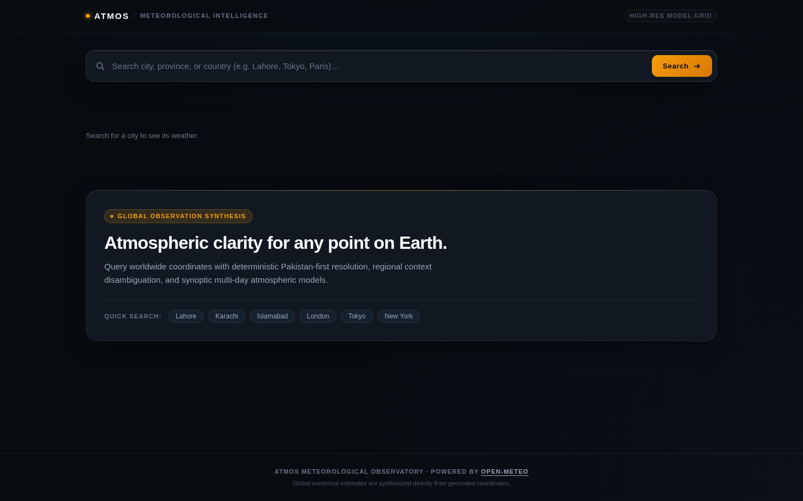
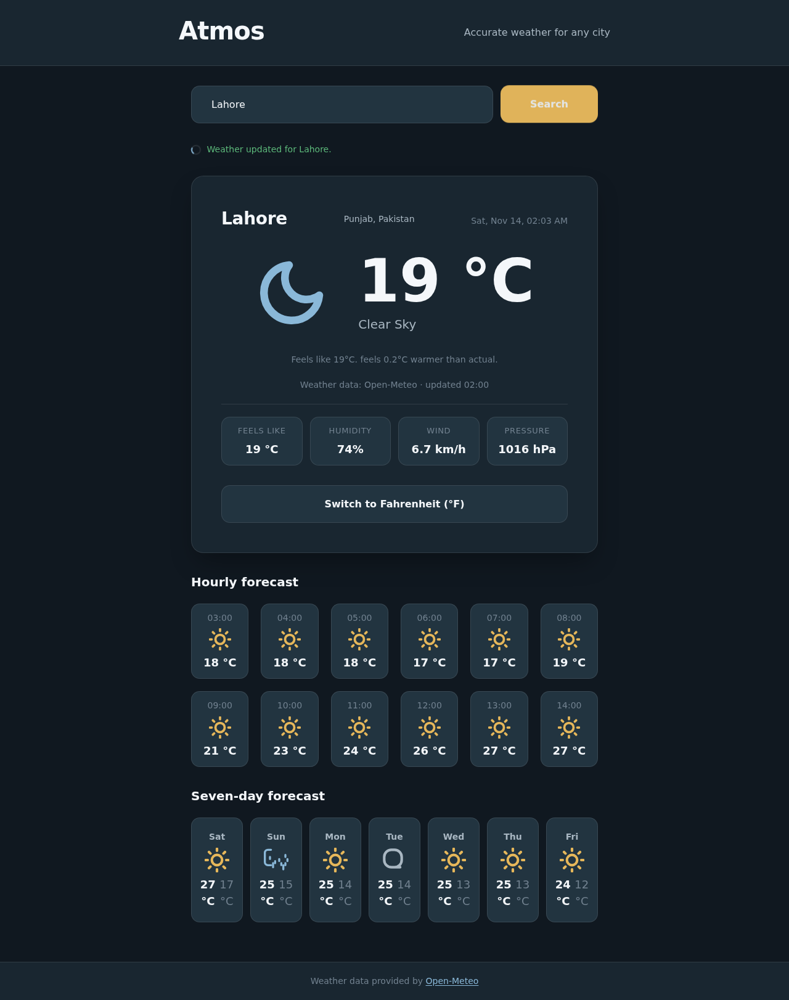

<div align="center">

# Atmos

### Weather for any city. Clear forecasts. Thoughtful location matching.

A responsive weather app powered by [Open-Meteo](https://open-meteo.com/), with current conditions, hourly and seven-day forecasts, and local time for the selected place.

[](https://open-meteo.com/)
[](https://developer.mozilla.org/docs/Web/JavaScript)
[](#verification)

</div>

## Preview

<p align="center">
  
  
</p>

## What you can do

- **Search globally:** Pakistan-first lookup for unqualified city names, with international fallback when there is no reliable Pakistani match.
- **Choose the right place:** country and region qualifiers are respected; ambiguous matches are shown as selectable options instead of silently choosing a location.
- **See current conditions:** temperature, feels-like temperature, humidity, wind, pressure, and a weather condition icon.
- **Plan ahead:** hourly conditions and a seven-day forecast use the selected location’s timezone.
- **Switch units:** toggle between Celsius and Fahrenheit without converting the underlying value repeatedly.
- **Use it on any screen:** responsive layout, keyboard-accessible controls, reduced-motion support, and clear loading and error states.

## Data and accuracy

Atmos uses the Open-Meteo Geocoding API to find places and the Forecast API for weather data. Forecast requests use the selected place’s coordinates and automatic timezone detection.

Current values are **weather-model estimates**, not direct thermometer readings. Open-Meteo may return model-grid coordinates slightly different from the requested city coordinates, and forecast coverage varies by place.

- [Open-Meteo Geocoding API](https://open-meteo.com/en/docs/geocoding-api)
- [Open-Meteo Forecast API](https://open-meteo.com/en/docs)

## Run locally

The app is static and can be served with Python:

```sh
python3 -m http.server 8000
```

Then open [http://localhost:8000](http://localhost:8000).

## Verification

Install the project’s test dependency once:

```sh
npm ci
```

Run deterministic unit and browser-fixture suites from the project root:

```sh
npm test
```

These tests use controlled fixtures for repeatable results. For checks against **real Open-Meteo responses**, use the live commands below; they require an internet connection and do not replace API responses with fixtures:

```sh
npm run verify:live:matrix       # finite 42-place provider matrix
npm run verify:mirpur            # live Mirpur geocoding queries
npm run test:e2e:live            # live browser searches across eight cities
npm run test:e2e:live:mirpur     # live browser regression for five Mirpur queries
```

## Project links

- [Open-Meteo](https://open-meteo.com/)
- [Geocoding documentation](https://open-meteo.com/en/docs/geocoding-api)
- [Forecast documentation](https://open-meteo.com/en/docs)
